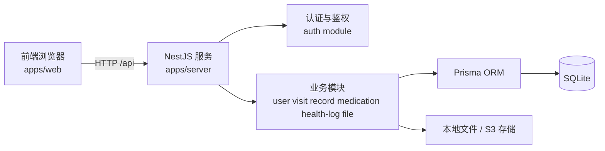
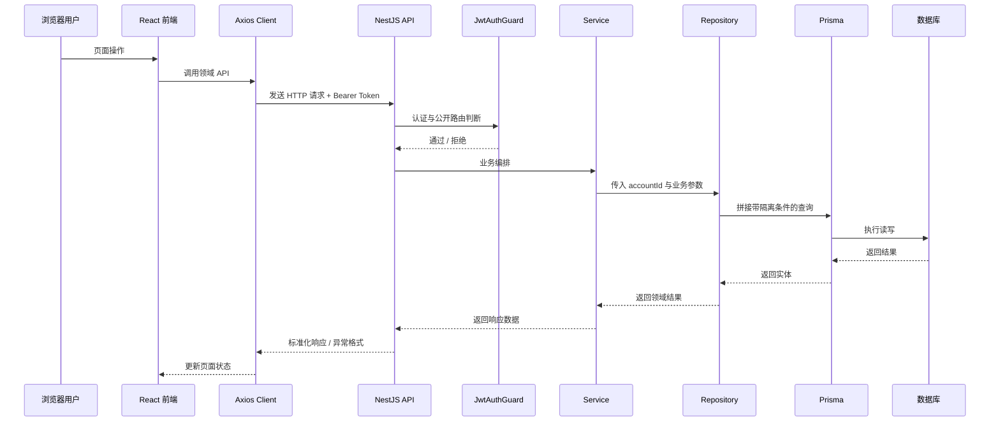
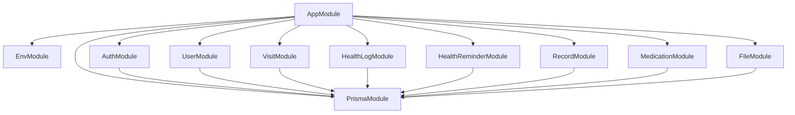
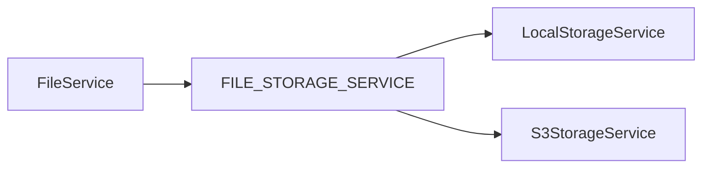
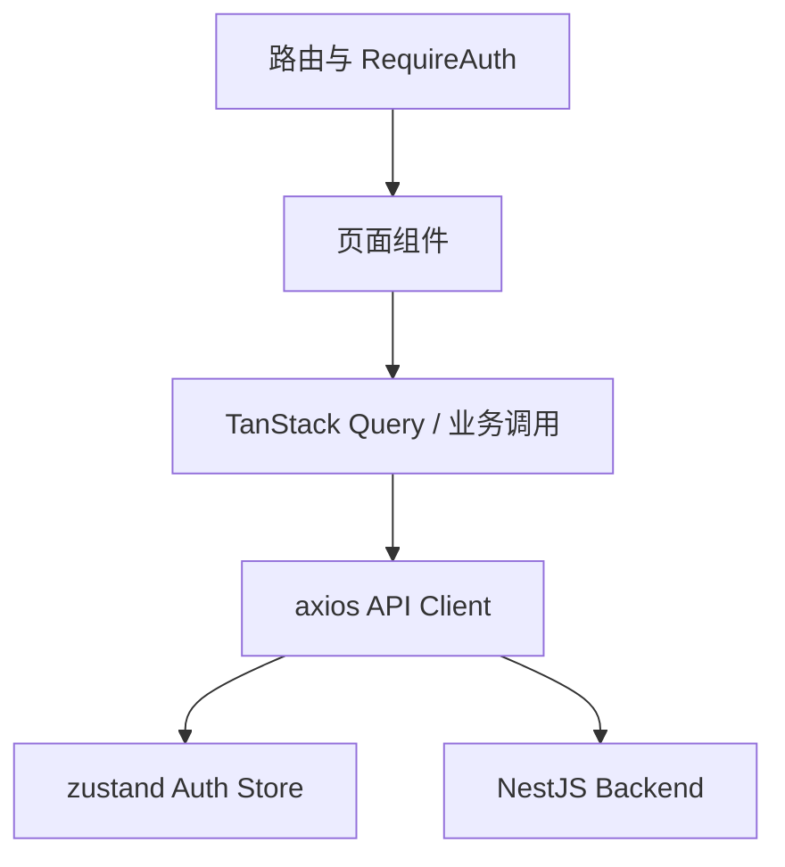
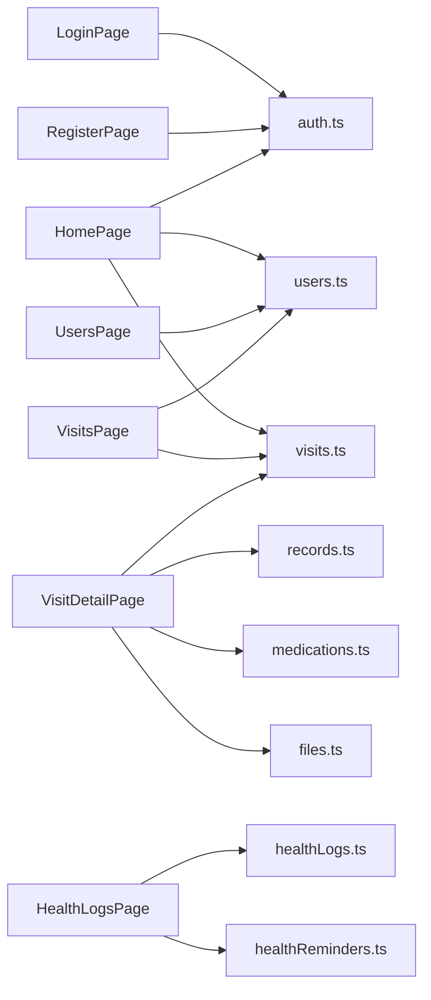
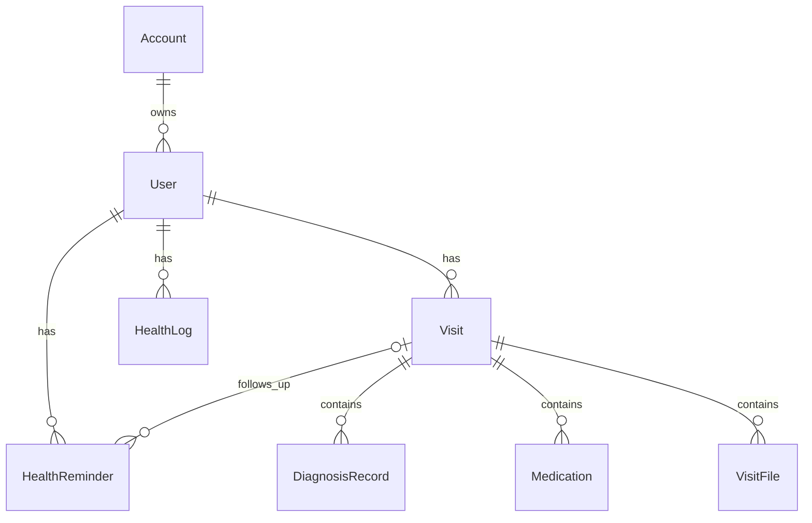
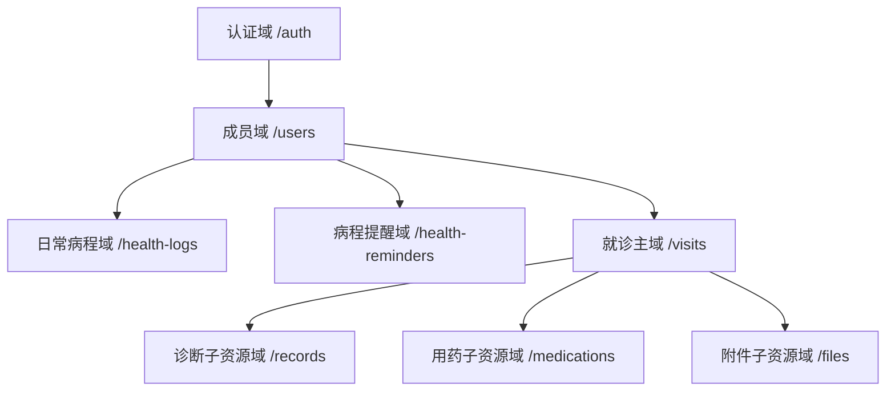

# 工程架构总览

## 1. 文档目的

本文档用于从工程视角说明医疗记录系统的整体结构、模块边界、关键数据流与核心设计约束。

本文不替代以下文档：

- 进度与阶段状态请查看 [PLAN.md](./PLAN.md)
- 会话续接方式请查看 [../PLAN_USAGE.md](../PLAN_USAGE.md)
- 历史实现过程请查看 [session-implementation-record-2026-04-30.md](./session-implementation-record-2026-04-30.md)

## 1.1 推荐阅读路径

如果是首次接触本工程，建议按以下顺序阅读：

1. 先阅读 [../README.md](../README.md)，了解系统用途、启动方式与主要能力。
2. 再阅读本文档，理解前后端、数据层、存储层和测试层如何协作。
3. 如需查看当前实施状态，阅读 [PLAN.md](./PLAN.md)。
4. 如需理解关键设计取舍，阅读 [design/auth-and-account-model.md](./design/auth-and-account-model.md)、[design/account-isolation.md](./design/account-isolation.md)、[design/file-storage-and-replace-flow.md](./design/file-storage-and-replace-flow.md)。

## 1.2 本文覆盖范围

本文重点回答以下问题：

- 整个仓库由哪些部分组成。
- 前端、后端、数据库、文件存储之间如何协作。
- 核心领域模型是什么，数据如何沿模块流动。
- 当前测试与部署形态处在什么阶段。

本文不展开接口字段级说明，也不记录单次任务的完整变更历史。

## 2. 系统边界

系统由以下部分组成：

- 前端单页应用：位于 `apps/web/`，负责登录、成员管理、就诊与日常病程记录。
- 后端服务：位于 `apps/server/`，负责认证、业务 CRUD、文件存储、病程记录与账号隔离。
- 数据库：当前仅配置并使用 SQLite；PostgreSQL 是后续迁移方向，尚未实现或验证。
- 文件存储：当前支持本地存储，并已预留 S3 兼容存储实现。
- 文档与运维资产：位于 `docs/` 与 `docker/`。

## 3. 总体架构图

## 3.1 运行拓扑说明

在本地开发模式下，系统通常由以下进程组成：

- `apps/web` 中的 Vite 开发服务器，对外提供浏览器页面。
- `apps/server` 中的 NestJS 服务，对外提供 `/auth`、`/users`、`/visits` 等业务接口。
- Prisma 连接的数据库，当前默认是 SQLite 文件库。
- 文件存储目标，默认是后端本地目录，未来可切换为 S3 兼容对象存储。

开发时前端通过代理把 `/api/*` 请求转发到后端，因此浏览器侧只感知一个统一入口。

## 3.2 核心请求链路

## 4. 代码目录结构

### 4.1 后端结构

- `apps/server/src/app.module.ts`：模块装配入口。
- `apps/server/src/main.ts`：应用启动、全局校验、异常过滤器、日志拦截器。
- `apps/server/src/modules/auth/`：注册、登录、当前账号、JWT 鉴权。
- `apps/server/src/modules/user/`：家庭成员管理。
- `apps/server/src/modules/visit/`：就诊记录管理。
- `apps/server/src/modules/health-log/`：家庭成员日常病程记录及体温/服药/症状事件。
- `apps/server/src/modules/health-reminder/`：家庭成员体温、服药与自定义提醒。
- `apps/server/src/modules/record/`：诊断记录管理。
- `apps/server/src/modules/medication/`：用药记录管理。
- `apps/server/src/modules/file/`：附件上传、替换、删除与存储实现。
- `apps/server/src/modules/export/`：按当前账号导出 JSON 或包含附件原件的流式 ZIP。
- `apps/server/src/prisma/`：Prisma 模块与服务。
- `apps/server/prisma/schema.prisma`：数据模型定义。

后端目录总体遵循“公共基础设施 + 领域模块 + Prisma 数据访问”的分层。

### 4.2 前端结构

- `apps/web/src/App.tsx`：前端路由入口。
- `apps/web/src/layouts/`：页面布局。
- `apps/web/src/pages/auth/`：登录与注册页。
- `apps/web/src/pages/home/`：首页。
- `apps/web/src/pages/users/`：家庭成员页面。
- `apps/web/src/pages/visits/`：就诊列表与详情页。
- `apps/web/src/pages/health-logs/`：手机优先的日常病程时间线。
- `apps/web/src/api/`：按领域拆分的 API 封装。
- `apps/web/src/store/`：登录态与账户信息状态管理。
- `apps/web/src/routes/RequireAuth.tsx`：受保护路由。

前端目录总体遵循“页面路由 + API 封装 + 本地会话状态 + 通用布局”的组织方式。

### 4.3 文档与部署结构

- `docs/`：计划、架构、设计、实施记录、运行手册与 ADR。
- `docker/` 与 `docker-compose.yml`：容器化相关配置。
- [Docker Compose 部署运行手册](runbooks/docker-deployment.md)：镜像构建、数据卷、识别 worker、升级和备份恢复流程。

### 4.4 模块级代码导航

如果需要快速进入真实代码，而不是只停留在目录层，建议按下表阅读。

#### 后端模块导航

| 模块 | 建议入口顺序 | 主要关注点 |
| --- | --- | --- |
| `auth` | `auth.controller.ts` -> `auth.service.ts` -> `auth.repository.ts` -> `dto/` -> `guards/` / `strategies/` / `decorators/` | 注册、登录、当前账号、JWT 鉴权链路 |
| `user` | `user.controller.ts` -> `user.service.ts` -> `user.repository.ts` -> `dto/` | 家庭成员 CRUD 与最少保留一个成员约束 |
| `visit` | `visit.controller.ts` -> `visit.service.ts` -> `visit.repository.ts` -> `dto/` | 就诊主聚合、筛选、分页、排序 |
| `health-log` | `health-log.controller.ts` -> `health-log.service.ts` -> `health-log.repository.ts` -> `dto/` | 体温、实际服药、症状与日常病程时间线 |
| `health-reminder` | `health-reminder.controller.ts` -> `health-reminder.service.ts` -> `health-reminder.repository.ts` -> `dto/` | 成员提醒的创建、管理、完成与稍后处理 |
| `record` | `record.controller.ts` -> `record.service.ts` -> `record.repository.ts` -> `dto/` | 诊断记录读写与账号边界 |
| `medication` | `medication.controller.ts` -> `medication.service.ts` -> `medication.repository.ts` -> `dto/` | 用药记录读写与账号边界 |
| `file` | `file.controller.ts` -> `file.service.ts` -> `file.repository.ts` -> `storage/` -> `dto/` | 附件上传、替换、删除与存储切换 |

#### 后端测试导航

| 类型 | 入口文件 | 主要价值 |
| --- | --- | --- |
| 端到端隔离测试 | `apps/server/src/account-isolation.spec.ts` | 验证跨账号访问被拒绝 |
| 仓储层测试 | `*.repository.spec.ts` | 验证 Prisma 访问与账号过滤逻辑 |
| 服务层测试 | `*.service.spec.ts` | 验证领域行为与异常分支 |

#### 前端模块导航

| 分组 | 建议入口顺序 | 主要关注点 |
| --- | --- | --- |
| 路由入口 | `src/App.tsx` -> `src/routes/RequireAuth.tsx` -> `src/layouts/AppLayout.tsx` | 页面装配、受保护路由、全局布局 |
| 认证页 | `src/pages/auth/LoginPage.tsx` / `RegisterPage.tsx` -> `src/api/auth.ts` -> `src/store/auth.ts` | 登录、注册、登录态落库 |
| 成员页 | `src/pages/users/UsersPage.tsx` -> `src/api/users.ts` | 成员列表与维护 |
| 就诊列表 | `src/pages/visits/VisitsPage.tsx` -> `src/api/visits.ts` | 就诊搜索、筛选、排序、分页 |
| 就诊详情 | `src/pages/visits/VisitDetailPage.tsx` -> `src/api/records.ts` / `medications.ts` / `files.ts` | 诊断、用药、附件的聚合操作 |
| 病程记录 | `src/pages/health-logs/HealthLogsPage.tsx` -> `src/api/healthLogs.ts` | 快速记录、体温趋势、成员时间线 |
| 病程提醒 | `src/pages/health-logs/HealthLogsPage.tsx` -> `src/api/healthReminders.ts` | 提醒管理、到期提示、跳转体温/服药录入 |

对新成员来说，最短的理解路径通常是：

1. 从前端 `src/App.tsx` 理解页面路由。
2. 进入 `VisitsPage.tsx` 与 `VisitDetailPage.tsx` 观察核心业务交互。
3. 跳到对应的后端 `visit`、`record`、`medication`、`file` 模块。
4. 最后阅读 `schema.prisma`，把代码行为和数据模型对应起来。

## 5. 后端架构

### 5.1 模块划分

后端采用 NestJS 模块化结构，并以领域模块为主线组织代码。典型链路为：

`Controller -> Service -> Repository -> Prisma`

各模块职责如下：

| 模块 | 主要职责 | 说明 |
| --- | --- | --- |
| `auth` | 注册、登录、当前账号信息、JWT 认证 | 登录主体是 `Account` |
| `user` | 家庭成员管理 | 一个账号可维护多个成员 |
| `visit` | 就诊记录管理 | 作为诊断、用药、附件的聚合根 |
| `record` | 诊断记录管理 | 从属于某次就诊 |
| `medication` | 用药记录管理 | 从属于某次就诊 |
| `file` | 上传、替换、删除附件 | 含存储抽象与供应商切换 |

公共基础设施则包括：

- `config`：环境变量加载与校验。
- `common/filters`：统一异常输出。
- `common/interceptors`：日志记录。
- `common/utils`：字符串处理、校验错误格式化等公共函数。
- `prisma`：数据库访问基础模块。

### 5.2 请求处理链路

1. 请求进入 NestJS 应用。
2. 全局 `JwtAuthGuard` 默认保护接口，`@Public()` 用于放行公开路由。
3. `ValidationPipe` 负责 DTO 校验与类型转换。
4. Service 负责业务编排。
5. Repository 负责将账号隔离与查询条件下沉到 Prisma 层。
6. `HttpExceptionFilter` 统一异常输出。
7. `LoggingInterceptor` 记录请求日志与耗时。

其中有三个横切点需要重点理解：

- `ValidationPipe` 开启 `whitelist`、`transform` 与 `forbidNonWhitelisted`，因此 DTO 之外的输入字段会被拒绝。
- `HttpExceptionFilter` 会将异常标准化为统一 JSON 结构，便于前端统一提取错误消息。
- `LoggingInterceptor` 记录请求方法、路径、响应状态和耗时，便于开发期与排障期观察调用路径。

### 5.3 鉴权与账号隔离

- 登录主体是 `Account`。
- 被管理对象是 `User`，表示家庭成员。
- 所有受保护资源都通过 `accountId` 进行隔离。
- 账号隔离的关键约束不只放在 Service，而是下沉到 Repository 的 Prisma `where` 条件中。

这一约束是本工程最重要的安全边界之一。它的核心目标不是“接口登录后可访问”，而是“登录后只能访问当前账号拥有的数据”。

典型数据边界如下：

- `Account` 直接拥有多个 `User`
- `Visit` 通过 `userId` 间接归属到某个 `Account`
- `HealthLog` 通过 `userId` 间接归属到某个 `Account`
- `HealthReminder` 通过 `userId` 间接归属到某个 `Account`
- 与就诊关联的 `HealthReminder` 还通过 `visitId` 校验来源就诊属于同一账号和成员
- `DiagnosisRecord`、`Medication`、`VisitFile` 再通过 `visitId` 间接归属到某个 `Account`

因此仓储层查询通常需要使用关系条件，而不是只按主键命中。

### 5.3.1 模块 -> Service -> Repository -> Prisma 约束对照表

下表用于说明账号隔离在后端不是停留在抽象原则，而是如何逐层落到真实代码中。

| 模块 | Service 主要职责 | Repository 边界 | Prisma 典型隔离约束 |
| --- | --- | --- | --- |
| `auth` | 注册账号、登录校验、返回当前账号 | 注册时按用户名和邮箱查重；登录支持用户名，旧账号兼容邮箱 | 认证域主要围绕 `Account`，不走业务资源跨账号过滤 |
| `user` | 成员 CRUD、保证账号下至少保留一个成员 | 仅允许访问当前账号下的成员 | `where: { accountId }`、`where: { id, accountId }`，更新/删除使用 `updateMany` / `deleteMany` |
| `visit` | 校验成员归属、处理筛选/排序/分页、维护就诊主记录 | 仅允许访问当前账号成员名下的就诊 | `where: { user: { accountId } }`，创建前先校验 `userId + accountId` |
| `health-log` | 校验成员归属、记录体温/用药/症状、按时间范围查询病程 | 仅允许访问当前账号成员名下的病程记录 | `where: { user: { accountId } }`，创建前先校验 `userId + accountId` |
| `record` | 基于某次就诊新增、更新、删除诊断 | 仅允许访问当前账号就诊下的诊断记录 | `where: { visit: { user: { accountId } } }`，创建前先校验 `visitId + accountId` |
| `medication` | 基于某次就诊新增、更新、删除用药 | 仅允许访问当前账号就诊下的用药记录 | `where: { visit: { user: { accountId } } }`，更新/删除使用关系过滤 |
| `file` | 上传、替换、删除附件并协调存储 | 仅允许访问当前账号就诊下的附件记录 | `where: { id, visit: { user: { accountId } } }`，上传前先校验 `visitId + accountId` |

可把这条后端主线压缩理解为：

`Controller 获取 accountId -> Service 做业务编排 -> Repository 追加隔离条件 -> Prisma 执行受限查询`

### 5.3.2 仓储层隔离模式

当前代码里主要存在三种隔离模式：

1. 直接资源归属账号
  - 典型对象：`User`
  - 典型条件：`where: { accountId }`
2. 资源通过成员归属账号
  - 典型对象：`Visit`
  - 典型条件：`where: { user: { accountId } }`
3. 资源通过就诊再间接归属账号
  - 典型对象：`DiagnosisRecord`、`Medication`、`VisitFile`
  - 典型条件：`where: { visit: { user: { accountId } } }`

这三种模式几乎覆盖了本工程全部业务资源的权限边界，也是阅读 repository 代码时最值得优先寻找的模式。

## 5.4 模块依赖关系

### 5.5 文件存储

文件模块支持：

- 上传附件
- 列出就诊附件
- 替换现有附件
- 删除附件

附件替换流程采用“先写入新文件，再更新数据库，再删除旧文件”的顺序，以降低中间状态造成数据丢失的风险。

文件存储层通过抽象令牌选择具体实现，当前支持两种提供者：

- 本地文件系统实现
- S3 兼容对象存储实现

后端会根据环境变量切换存储提供者，因此业务层不直接依赖具体供应商。

## 6. 前端架构

### 6.1 路由结构

前端当前路由包括：

- `/login`
- `/register`
- `/`
- `/users`
- `/visits`
- `/visits/:id`

其中 `/`、`/users`、`/visits` 与 `/visits/:id` 都包裹在 `RequireAuth` 之下，未登录状态会被重定向到 `/login`。

### 6.2 状态管理

- 使用 `zustand` 管理认证状态。
- 使用 `axios` 拦截器注入 Bearer Token 并处理 401。
- 使用 TanStack Query 管理服务端数据请求与缓存。

当前前端会话机制的核心流程如下：

1. 登录成功后，将 `token` 与 `account` 保存到 `zustand` 持久化存储。
2. 后续 API 请求由 `axios` 客户端统一附加 Bearer Token。
3. 如果后端返回 401，客户端会清空本地会话并跳转登录页。

### 6.3 页面职责

- 登录 / 注册：认证入口。
- 首页：账号与业务概览。
- 成员页：家庭成员增删改查。
- 就诊列表页：就诊筛选、分页、排序。
- 就诊详情页：诊断、用药、附件管理。

### 6.4 前端交互分层

前端当前可理解为四层：

| 分层 | 位置 | 职责 |
| --- | --- | --- |
| 路由层 | `src/App.tsx`、`src/routes/` | 页面入口与登录保护 |
| 页面层 | `src/pages/` | 表单、列表、详情与用户交互 |
| API 层 | `src/api/` | 按领域组织请求函数与错误提取 |
| 会话状态层 | `src/store/` | token 与账号信息持久化 |

### 6.5 页面级代码阅读建议

如果希望从前端界面出发理解整套工程，建议按以下顺序：

1. `src/pages/auth/`：看清登录入口、注册入口和登录态建立方式。
2. `src/pages/users/UsersPage.tsx`：理解最简单的成员 CRUD 交互。
3. `src/pages/visits/VisitsPage.tsx`：理解就诊列表聚合、搜索与排序。
4. `src/pages/visits/VisitDetailPage.tsx`：理解本工程的核心业务闭环，包含诊断、用药、附件。

其中 `VisitDetailPage.tsx` 是前端最值得优先阅读的页面之一，因为它最集中地体现了领域聚合关系。

### 6.6 前端页面到 API 映射表

下表描述“页面实际调用哪些前端 API 模块，以及这些模块最终落到哪些后端接口域”。

| 前端页面 | 主要前端 API | 对应后端接口域 | 主要用途 |
| --- | --- | --- | --- |
| `/login` | `src/api/auth.ts#login` | `POST /auth/login` | 登录并建立会话 |
| `/register` | `src/api/auth.ts#register` | `POST /auth/register` | 注册账号并创建默认成员 |
| `/` | `src/api/auth.ts#fetchCurrentAccount`、`src/api/users.ts#listUsers`、`src/api/visits.ts#listVisits` | `GET /auth/me`、`GET /users`、`GET /visits` | 首页统计与当前账号概览 |
| `/users` | `src/api/users.ts#listUsers`、`createUser`、`updateUser`、`deleteUser` | `GET/POST/PATCH/DELETE /users` | 家庭成员管理 |
| `/visits` | `src/api/users.ts#listUsers`、`src/api/visits.ts#listVisits`、`createVisit`、`deleteVisit` | `GET /users`、`GET/POST/DELETE /visits` | 就诊筛选、列表、新增、删除 |
| `/visits/:id` | `src/api/visits.ts#getVisit`、`src/api/records.ts`、`src/api/medications.ts`、`src/api/files.ts` | `GET /visits/:id`、`/records`、`/medications`、`/files` 相关接口 | 就诊详情、诊断/用药/附件聚合操作 |
| `/health-logs` | `src/api/healthLogs.ts` | `GET/POST /health-logs`、`PATCH/DELETE /health-logs/:id` | 快捷记录、体温趋势、成员时间线 |
| `/health-reminders` | `src/api/healthReminders.ts` | `GET/POST /health-reminders`、`PATCH/DELETE /health-reminders/:id`、`POST /:id/action` | 管理与处理成员提醒 |

从页面角度看，API 依赖呈现为“认证域、成员域、就诊域、就诊子资源域”四层逐步展开。

### 6.7 页面 -> API -> 后端模块 -> 数据模型 映射表

下表用于把前端操作链路和后端代码落点、数据主线统一到一张表里。

| 页面 / 路由 | 前端 API 模块 | 后端模块 / 典型路由 | 主要数据模型 |
| --- | --- | --- | --- |
| `LoginPage` `/login` | `src/api/auth.ts#login` | `auth.controller.ts` -> `POST /auth/login` | `Account` |
| `RegisterPage` `/register` | `src/api/auth.ts#register` | `auth.controller.ts` -> `POST /auth/register` | `Account`、`User` |
| `HomePage` `/` | `src/api/auth.ts#fetchCurrentAccount`、`src/api/users.ts#listUsers`、`src/api/visits.ts#listVisits` | `auth` -> `GET /auth/me`、`user` -> `GET /users`、`visit` -> `GET /visits` | `Account`、`User`、`Visit` |
| `UsersPage` `/users` | `src/api/users.ts#listUsers`、`createUser`、`updateUser`、`deleteUser` | `user.controller.ts` -> `GET/POST/PATCH/DELETE /users...` | `User` |
| `VisitsPage` `/visits` | `src/api/users.ts#listUsers`、`src/api/visits.ts#listVisits`、`createVisit`、`deleteVisit` | `user` -> `GET /users`、`visit.controller.ts` -> `GET/POST/DELETE /visits...` | `User`、`Visit` |
| `VisitDetailPage` `/visits/:id` 基础详情 | `src/api/visits.ts#getVisit` | `visit.controller.ts` -> `GET /visits/:id` | `Visit`、`User` |
| `VisitDetailPage` 诊断区块 | `src/api/records.ts#createRecord`、`updateRecord`、`deleteRecord` | `record.controller.ts` -> `POST/PATCH/DELETE /records...`、`GET /visits/:visitId/records` | `DiagnosisRecord`、`Visit` |
| `VisitDetailPage` 用药区块 | `src/api/medications.ts#createMedication`、`updateMedication`、`deleteMedication` | `medication.controller.ts` -> `POST/PATCH/DELETE /medications...`、`GET /visits/:visitId/medications` | `Medication`、`Visit` |
| `VisitDetailPage` 附件区块 | `src/api/files.ts#uploadFile`、`replaceFile`、`deleteFile` | `file.controller.ts` -> `POST /files/upload`、`PUT /files/:id`、`DELETE /files/:id`、`GET /visits/:visitId/files` | `VisitFile`、`Visit` |
| `VisitDetailPage` 随访区块 | `src/api/healthReminders.ts` 的关联列表、创建、更新、动作、删除 | `health-reminder.controller.ts` -> `/health-reminders`；服务端同时校验 `visitId`、`userId` 与账号 | `HealthReminder`、`Visit`、`User` |
| `HealthLogsPage` `/health-logs` | `src/api/healthLogs.ts` 的列表、新建、更新、删除 | `health-log.controller.ts` -> `GET/POST /health-logs`、`PATCH/DELETE /health-logs/:id` | `HealthLog`、`User` |
| `HealthLogsPage` 提醒区 | `src/api/healthReminders.ts` 的列表、创建、更新、动作、删除 | `health-reminder.controller.ts` -> `/health-reminders` CRUD 与 action | `HealthReminder`、`User` |
| 账号菜单 -> 数据导出 | `apiClient` -> `GET /export/archive` | `export.controller.ts` -> `ExportService` -> `FileService` / 当前账号文件存储 | 当前账号的医疗数据及 `VisitFile` 原件 |
| `VisitSummaryPage` `/visit-summary` AI 摘要 | `apiClient` -> `GET /ai/models`、`POST /ai/models/:id/summarize` | `ai.controller.ts` -> 当前启用的本机/局域网模型 | 用户确认发送的病程与就诊文字（不含附件） |

如果从工程主线来理解，这张表可以再压缩成下面这条链路：

`页面交互 -> 前端 API 封装 -> Controller/Service/Repository -> Prisma 模型`

这也是本项目排查问题时最有效的定位顺序之一。

## 7. 数据模型

当前核心模型主线如下：

`Account -> User -> Visit -> DiagnosisRecord / Medication / VisitFile`

日常病程记录从成员直接关联，与就诊主记录分开保存：`Account -> User -> HealthLog`。

成员日常提醒按成员关联；复诊/检查随访提醒还可选关联来源就诊：`Account -> User -> HealthReminder -> Visit`。

含义如下：

- `Account`：可登录账号。
- `User`：账号下维护的家庭成员。
- `Visit`：成员的就诊记录。
- `DiagnosisRecord`：诊断记录。
- `Medication`：用药记录。
- `VisitFile`：附件记录。
- `HealthLog`：成员按时间记录的体温、实际服药、症状及日常情况。
- `HealthReminder`：成员按本地日历时间设置的单次或每日重复提醒；就诊随访提醒可关联来源 `Visit`，一般提醒仍保持 `visitId = NULL`。

该模型体现了两个关键事实：

- 登录账号与家庭成员是分开的两个概念。
- `Visit` 子资源围绕就诊聚合；`HealthLog` 是成员下独立的日常病程数据，`HealthReminder` 按成员归属并可选关联某次就诊。

## 7.1 接口域地图

后端接口按领域可划分为 8 个域，每个域在前端也有对应的 API 封装模块。

| 接口域 | 前端 API 模块 | 典型后端接口 | 主要职责 |
| --- | --- | --- | --- |
| 认证域 | `src/api/auth.ts` | `POST /auth/register`、`POST /auth/login`、`GET /auth/me` | 建立与恢复登录会话 |
| 成员域 | `src/api/users.ts` | `POST /users`、`GET /users`、`PATCH /users/:id`、`DELETE /users/:id` | 维护账号下家庭成员 |
| 日常病程域 | `src/api/healthLogs.ts` | `POST/GET /health-logs`、`PATCH/DELETE /health-logs/:id` | 维护成员按时间记录的体温、服药和症状 |
| 病程提醒域 | `src/api/healthReminders.ts` | `/health-reminders` CRUD 与 action | 维护成员体温、服药及自定义提醒 |
| 就诊主域 | `src/api/visits.ts` | `POST /visits`、`GET /visits`、`GET /visits/:id`、`PATCH /visits/:id`、`DELETE /visits/:id` | 管理就诊主记录与筛选聚合 |
| 诊断子资源域 | `src/api/records.ts` | `POST /records`、`GET /visits/:visitId/records`、`PATCH /records/:id`、`DELETE /records/:id` | 管理就诊下的诊断记录 |
| 用药子资源域 | `src/api/medications.ts` | `POST /medications`、`GET /visits/:visitId/medications`、`PATCH /medications/:id`、`DELETE /medications/:id` | 管理就诊下的用药记录 |
| 附件子资源域 | `src/api/files.ts` | `POST /files/upload`、`GET /visits/:visitId/files`、`PUT /files/:id`、`DELETE /files/:id` | 管理就诊下的附件上传、替换与删除 |

接口域之间的依赖关系并不是并列平铺的，而是存在明显聚合主线：

这张图反映的不是调用先后顺序，而是业务归属关系：账号登录后先拥有成员，成员再拥有就诊，就诊再聚合诊断、用药和附件。

## 8. 测试策略

- 后端已具备 Service / Repository 单元测试。
- 后端包含账号隔离 e2e 测试，用于验证跨账号读写被拒绝。
- 前端已配置 Vitest，但自动化用例仍有扩展空间。

当前测试的重点不是单纯追求覆盖率，而是优先覆盖高风险边界：

- 认证和登录流程
- 账号隔离
- 业务核心 CRUD
- 文件处理流程

详细测试执行方式请查看 [runbooks/testing.md](./runbooks/testing.md)。

## 9. 部署与运行形态

当前支持的主要运行形态：

- 本地 Node.js 开发运行
- Docker 容器化运行
- 后续演进：PostgreSQL + S3 / MinIO

### 9.1 本地开发形态

- 后端直接运行在 Node.js 进程中。
- 前端运行在 Vite 开发服务器中。
- 数据库存放为本地 SQLite 文件。
- 上传文件默认落在后端本地目录。

### 9.2 后续演进方向

- 将数据库切换为 PostgreSQL，以支撑更稳健的数据管理与部署方式。
- 将文件存储切换到 S3 / MinIO，以替代本地文件系统。
- 继续补齐审计日志、导出备份、构建优化等工程能力。

## 10. 关键文件索引

下列文件可作为快速进入代码的起点：

| 主题 | 关键文件 |
| --- | --- |
| 后端启动 | `apps/server/src/main.ts` |
| 后端模块装配 | `apps/server/src/app.module.ts` |
| 数据模型 | `apps/server/prisma/schema.prisma` |
| 账号隔离 e2e | `apps/server/src/account-isolation.spec.ts` |
| 文件存储切换 | `apps/server/src/modules/file/file.module.ts` |
| 前端路由入口 | `apps/web/src/App.tsx` |
| 路由守卫 | `apps/web/src/routes/RequireAuth.tsx` |
| 前端 API 客户端 | `apps/web/src/api/client.ts` |
| 前端认证状态 | `apps/web/src/store/auth.ts` |

## 10.1 按问题定位代码

当你带着具体问题进入代码时，可优先按下表定位：

| 你想回答的问题 | 建议先看 |
| --- | --- |
| 为什么这个接口默认需要登录 | `apps/server/src/app.module.ts`、`apps/server/src/modules/auth/guards/` |
| 为什么不同账号看不到彼此数据 | `apps/server/src/account-isolation.spec.ts`、各模块 `*.repository.ts` |
| 登录态为什么会自动失效并跳回登录页 | `apps/web/src/api/client.ts`、`apps/web/src/store/auth.ts` |
| 就诊详情页为什么能同时管理诊断、用药、附件 | `apps/web/src/pages/visits/VisitDetailPage.tsx` 及对应后端模块 |
| 文件为什么可以在本地和 S3 之间切换 | `apps/server/src/modules/file/file.module.ts`、`apps/server/src/modules/file/storage/` |
| 数据表之间如何关联 | `apps/server/prisma/schema.prisma` |

## 10.2 常见问题定位路径

本节用于回答“出现某类故障时，应该先看哪里”。推荐先按最短链路定位，不要一开始就横向扫全仓。

### 登录失败

优先排查顺序：

1. 前端登录入口：`apps/web/src/pages/auth/LoginPage.tsx`
2. 前端认证 API：`apps/web/src/api/auth.ts`
3. 前端错误提取与 401 处理：`apps/web/src/api/client.ts`
4. 后端公开路由与控制器：`apps/server/src/modules/auth/auth.controller.ts`
5. 后端登录业务：`apps/server/src/modules/auth/auth.service.ts`
6. JWT 配置与鉴权策略：`apps/server/src/modules/auth/auth.module.ts`、`apps/server/src/modules/auth/strategies/jwt.strategy.ts`

典型判断思路：

- 如果请求根本没发出去，先看前端表单提交与 axios 配置。
- 如果返回 401，先看 token 是否存在、`/auth/login` 是否被 `@Public()` 放行、JWT 配置是否正常。
- 如果返回业务错误，先看 `auth.service.ts` 与异常消息。

### 跨账号访问异常

适用场景包括：

- 本该被拒绝的跨账号访问却成功了
- 本账号自己的数据反而访问不到

优先排查顺序：

1. 账号隔离 e2e：`apps/server/src/account-isolation.spec.ts`
2. 对应模块 repository：`user.repository.ts`、`visit.repository.ts`、`record.repository.ts`、`medication.repository.ts`、`file.repository.ts`
3. 对应 service：确认是否把 `accountId` 正确传入 repository
4. Prisma 模型关系：`apps/server/prisma/schema.prisma`

典型判断思路：

- 先确认 repository 查询是否仍带有 `accountId` 或关系过滤。
- 再确认 service 没有遗漏把当前账号上下文向下传递。
- 最后确认问题对象是直接归属 `Account`、经 `User` 归属，还是经 `Visit` 间接归属。

### 附件上传或替换失败

优先排查顺序：

1. 前端详情页上传逻辑：`apps/web/src/pages/visits/VisitDetailPage.tsx`
2. 前端文件 API：`apps/web/src/api/files.ts`
3. 后端文件控制器：`apps/server/src/modules/file/file.controller.ts`
4. 后端文件业务：`apps/server/src/modules/file/file.service.ts`
5. 后端文件仓储：`apps/server/src/modules/file/file.repository.ts`
6. 存储实现与供应商切换：`apps/server/src/modules/file/file.module.ts`、`apps/server/src/modules/file/storage/`

典型判断思路：

- 如果上传控件无响应，先看前端 `customRequest` 是否触发。
- 如果接口报 404，先确认 `visitId` 或 `fileId` 是否属于当前账号。
- 如果数据库记录正常但文件异常，继续看本地存储或 S3 实现。
- 如果替换失败，重点看“先写新文件、再更新数据库、再删旧文件”的顺序是否被破坏。

### 就诊列表筛选 / 搜索 / 排序异常

优先排查顺序：

1. 前端列表页状态与筛选控件：`apps/web/src/pages/visits/VisitsPage.tsx`
2. 前端查询参数封装：`apps/web/src/api/visits.ts`
3. 后端控制器与查询 DTO：`apps/server/src/modules/visit/visit.controller.ts`、`apps/server/src/modules/visit/dto/`
4. 后端查询实现：`apps/server/src/modules/visit/visit.repository.ts`

典型判断思路：

- 如果界面筛选条件变了但请求参数没变，先看前端 query 参数组装。
- 如果请求参数正确但结果不对，重点看 repository 里 `q`、`sortBy`、`order`、时间范围和账号过滤如何一起组合。
- 如果排序显示不对，确认前端表头排序状态和后端默认排序是否一致。

### 一个通用排障顺序

多数问题都可以先按下面的固定顺序定位：

`页面事件 -> 前端 API -> 后端 Controller -> Service -> Repository -> Prisma 模型 / 存储实现`

如果是权限问题，把重点提前放到 `JwtAuthGuard`、`accountId` 传递和 repository 过滤条件；如果是文件问题，把重点提前放到 `file.service.ts` 与 `storage/`。

## 11. 关键设计约束

1. 默认所有后端接口受保护，公开接口必须显式声明。
2. 账号隔离必须在 Repository / Prisma 查询层体现，而不是仅在 Controller 或 Service 层做前置判断。
3. 文件替换必须优先保证数据库记录与新文件写入成功，再处理旧文件清理。
4. 文档更新应与代码变更一起维护，避免 README、PLAN 与真实实现漂移。
5. 架构文档应持续作为“全工程总览”，而不是沉淀为一次性的会话记录。
